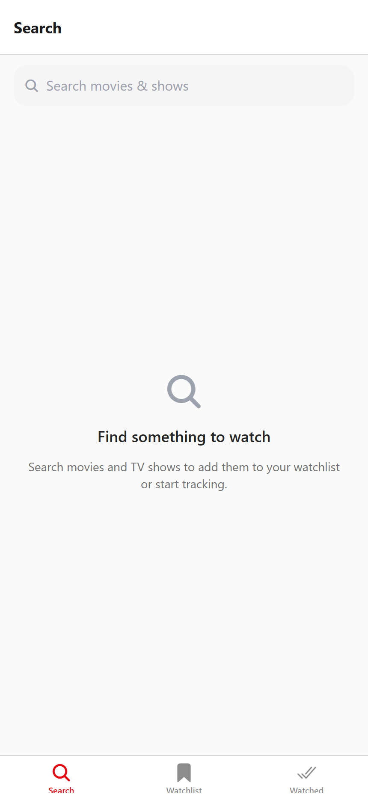
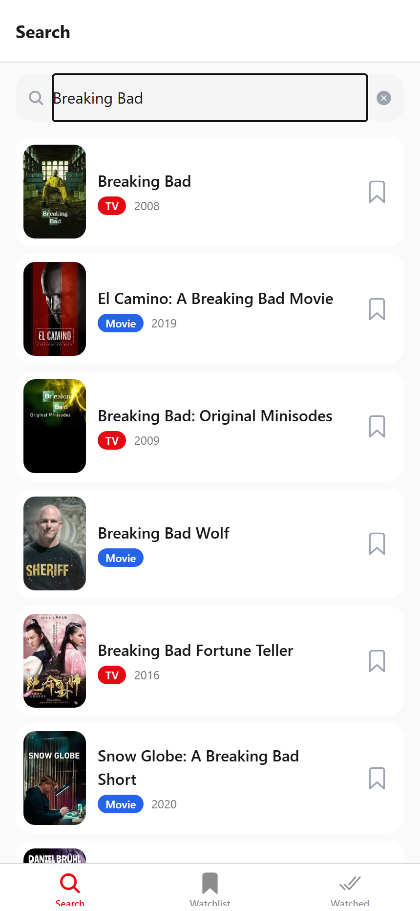
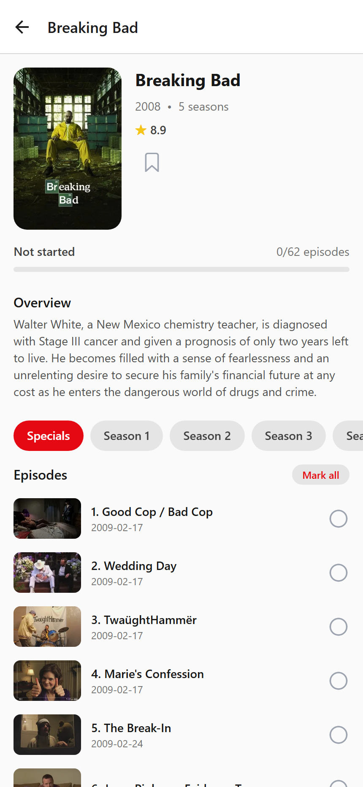
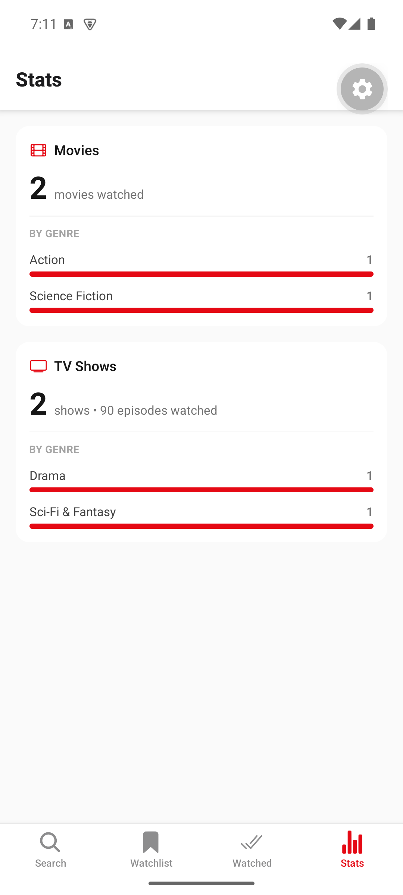

# 🎬 Seen It

A local-first mobile app to **track the movies & TV shows you've watched** and maintain a **"To Watch"** list. Search titles from [TMDB](https://www.themoviedb.org), mark movies as watched, and track TV shows **episode by episode** with a live progress bar — all stored on-device, no account required.

Built as a modern, cross-platform (iOS + Android) React Native app.

---

## ✨ Features

- 🔎 **Search** movies & TV shows via TMDB (posters, ratings, cast, genres). When the search box is empty, it shows **Trending this week**. Titles already in your library show a muted **✓ "in library"** marker. If your query matches a theme (TMDB keyword), an **"Explore the '…' theme"** chip opens a discovery list of similarly-tagged titles — without polluting the title results.
- 🎬 **Rich detail screens** — a subtle **backdrop hero** behind the header, plus tagline, age rating (PG-13 / TV-MA), studio (movies), network (shows), and a **"More like this"** recommendations carousel. Lists and detail screens use **skeleton loaders** while fetching.
- ✅ **Mark movies watched** with a single tap.
- 📺 **Per-episode TV tracking** — tick individual episodes, "mark all" a season, mark the **whole series** watched, or tap **↑ to mark everything up to an episode** (including previous seasons). Live progress bar. In the **Watching** and **Continue later** lists, a **Next** button marks the next unwatched episode in one tap (and resumes a paused show).
- 🔖 **"To Watch" watchlist** split into **Movies** and **TV Series** tabs. Items already watched or categorized no longer offer a "to watch" option.
- 🏷️ **TV show status** — *Watching* and *Completed* are auto-derived from episode progress; for a show you're still watching you can manually mark it **Stopped watching** or **Continue later** (these options are hidden once a show is completed). Manual flags don't affect stats and auto-clear the moment you watch another episode. If a **new season airs**, opening a completed show re-syncs its episode count from TMDB and it automatically returns to *Watching*.
- 🗂️ **Separate Movies and Series tabs** — watched movies in one tab; series split into **4 views** with counts: *Watching · Completed · Stopped watching · Continue later*.
- ↕️ **Sort your lists** — the **Movies**, **Series**, and **Watchlist** tabs each have a compact sort bar: **Recent** (default), **Title (A–Z)**, or **Release year**. Tap the active chip to flip the direction (↑/↓). Resets to Recent each launch.
- 🗓️ **Upcoming seasons/episodes** — shows still airing display a badge in the Series list and a banner on the show screen (from TMDB): **"New season · &lt;date&gt;"** / **"New episode · &lt;date&gt;"** when a date is known, or **"New season coming"** when the show is renewed/ongoing but nothing is scheduled yet. Airing shows also refresh more often than finished ones. Progress counts only **episodes released so far**, so announced-but-unaired episodes aren't shown as "remaining" (e.g. 20/21, not 20/26).
- 📊 **Stats** — totals, **total watch time**, and a per-genre breakdown, tracked separately for movies and TV shows. The genre list shows your **top 6** genres with a **Show all / Show less** toggle. Tap any genre to see the titles in it.
- 🎭 **Genres** shown on both movie and TV detail screens.
- 📥 **Import your library** — from **Settings → Import data** (or first-launch onboarding) you can bring in a **data export** (a `.zip` of JSON files). It imports your watched **movies and TV episodes**, maps each title to TMDB, mirrors your per-show status (*stopped* → Stopped watching, *watch later* → Continue later), adds not-yet-started titles to your **watchlist**, and lists anything it couldn't match with a downloadable **CSV report**.
- 📤 **Export / backup** — **Settings → Export data** saves your whole library to a `.zip` in the **same format the importer reads**, so you can back it up or move devices and re-import it (round-trip). Exported items carry their TMDB id, so re-importing resolves instantly and losslessly.
- 🌓 **Dark mode** — **Settings → Appearance** lets you pick **System / Light / Dark**; the choice is saved and applies across the whole app (screens, headers, tabs, status bar).
- 💾 **Offline-first** — your data lives on the device via MMKV. No sign-in.

---

## 📸 Screenshots

| Search | Live results | Per-episode tracking | Stats |
|---|---|---|---|
|  |  |  |  |

---

## 🧱 Tech Stack

| Concern | Choice |
|---|---|
| Framework | [Expo](https://expo.dev) (SDK 56) + React Native + TypeScript |
| Architecture | React Native **New Architecture** (Fabric / TurboModules) + React Compiler |
| Routing | [Expo Router](https://docs.expo.dev/router/introduction/) (file-based, typed routes) |
| Data fetching | [TanStack Query](https://tanstack.com/query) (caching, loading/error states) |
| App state | [Zustand](https://github.com/pmndrs/zustand) |
| Persistence | [react-native-mmkv](https://github.com/mrousavy/react-native-mmkv) via a Zustand `persist` adapter |
| Styling | [NativeWind](https://www.nativewind.dev) (Tailwind CSS for RN) |
| Data source | [TMDB API](https://developer.themoviedb.org) |
| Builds | [EAS Build](https://docs.expo.dev/build/introduction/) + Expo Dev Client |

---

## 🚀 Getting Started

### 1. Prerequisites

- [Node.js](https://nodejs.org) 20+ and npm
- An [Expo account](https://expo.dev/signup) + the EAS CLI for device builds: `npm i -g eas-cli`
- **Android:** Android Studio (works on Windows/macOS/Linux)
- **iOS:** built in the cloud with **EAS Build** — no Mac required

### 2. Install dependencies

```bash
npm install
```

### 3. Add your (free) TMDB API key

1. Create a free account at [themoviedb.org](https://www.themoviedb.org/signup).
2. Go to **Settings → API** and request an **API Key (v3 auth)**.
3. Copy the example env file and paste your key:

```bash
cp .env.example .env
```

```dotenv
# .env
EXPO_PUBLIC_TMDB_API_KEY=your_tmdb_v3_api_key_here
```

> The app runs without a key, but Search will prompt you to add one.

### 4. Run it

Because this app uses native modules (MMKV) and the New Architecture, it runs in a **custom Dev Client**, not Expo Go.

**Android (locally, incl. on Windows):**

```bash
npm run android      # builds & installs a dev build, then starts Metro
```

**iOS (via EAS cloud build — no Mac needed):**

```bash
eas login
eas build --profile development --platform ios
# Install the resulting build on your device / TestFlight, then:
npm start            # start the dev server and open it in the dev client
```

**Start the dev server for an already-installed dev client:**

```bash
npm start            # expo start --dev-client
```

> **Bonus — run in a browser (no emulator needed):** `npm run web` starts a web build (handy for quick demos and screenshots). On web, storage falls back to `localStorage` since MMKV is native-only; iOS/Android behaviour is unchanged.

---

## 🍏 Testing on iOS from Windows (no Mac)

The iOS Simulator is macOS-only, and Expo Go can't load this app (custom native modules). To exercise a
**real iOS Simulator from Windows**, build a standalone **simulator** build in the EAS cloud and stream it
in the browser with [Appetize.io](https://appetize.io):

```bash
# 1. Authenticate (free Expo account). In CI/non-interactive shells use EXPO_TOKEN instead of `eas login`.
eas login

# 2. One-time: link the project and provide the TMDB key to the cloud build
#    (the build has no local .env, so the key must live in EAS). Register it for
#    every environment you build for — here preview + production.
eas init
eas env:create --name EXPO_PUBLIC_TMDB_API_KEY --value <your-key> \
  --environment preview --environment production --visibility plaintext

# 3. Build the iOS *simulator* app (no Apple Developer account needed for simulator builds).
#    This repo isn't a git repo, so pass EAS_NO_VCS=1.
EAS_NO_VCS=1 eas build --platform ios --profile preview-simulator

# 4. Download the resulting .tar.gz artifact, then upload it to Appetize:
curl -X POST https://api.appetize.io/v1/apps \
  -H "X-API-KEY: <appetize-token>" \
  -F "file=@SeenIt-ios-sim.tar.gz" -F "platform=ios"
# → open the returned appURL and interact with the app in your browser.
```

The `preview-simulator` profile (in [`eas.json`](./eas.json)) sets `ios.simulator: true` and
`environment: preview`, so the build embeds the JS bundle (runs without your local Metro) with the TMDB
key baked in. Verified end-to-end: launch, search, dark/light/system, import/export all work on iOS.

---

## 📦 Building for Distribution

Build profiles live in [`eas.json`](./eas.json); each profile declares its `environment`, so the matching
EAS environment variables (notably `EXPO_PUBLIC_TMDB_API_KEY`) are injected at build time. **Register the
TMDB key for every environment you build** (see the `eas env:create` command above — use `--environment
preview --environment production`), otherwise search/data will be empty in the packaged app.

```bash
eas build --profile preview           --platform android   # shareable internal build
eas build --profile preview-simulator --platform ios       # iOS Simulator build (Appetize / Mac simulator)
eas build --profile production        --platform all        # store-ready builds
```

### Android

- **Share directly (no store, no cost):** `eas build --profile preview --platform android` produces an
  **APK** (`distribution: internal`). Anyone can install it by opening the EAS install link and allowing
  "install unknown apps".
- **Google Play:** `eas build --profile production --platform android` produces an **AAB**, then
  `eas submit --platform android` uploads it. Requires a one-time **Google Play Developer** account ($25).

#### Local sideload build (no Expo account) — `npm run apk`

For a personal sideloadable APK built entirely on your machine (no EAS login), run:

```bash
npm run apk          # → ./SeenIt-v<versionCode>.apk  (signed, standalone, key baked in)
```

This runs [`scripts/build-apk.ps1`](./scripts/build-apk.ps1): it restores the release keystore if needed,
runs `gradlew assembleRelease`, and copies the artifact to `SeenIt-v<versionCode>.apk`. Copy that file to
the phone, tap it, and choose **Install/Update**.

#### Delivering updates without data loss ⚠️

Installing a newer APK **over** the existing app is an in-place **update** — your on-device library
(MMKV) is kept — **as long as all three hold**:

1. **Same package id** — `com.moviesserieshub.app` (don't change it).
2. **Same signing key** — every release APK must be signed with the **same** keystore. Ours is a dedicated
   release key at `android/app/seenit-release.keystore`, wired into `android/app/build.gradle`
   (`signingConfigs.release`). It is **gitignored** and backed up under `credentials/` — **this file is the
   crown jewel; if you lose it you can no longer ship an in-place update** (a differently-signed APK forces
   an uninstall → data loss). Keep offline backups.
3. **Higher `versionCode`** — bump it every release in **both** `app.json` (`android.versionCode`) and
   `android/app/build.gradle` (`versionCode` + `versionName`).

Data is lost only if you **uninstall first** or the **signing key changes**. As a belt-and-suspenders
backup before any update, use **Settings → Export data** (round-trips through **Import data**). The
installed version is shown at the bottom of **Settings** (`v1.0.1 (build 2)`) so you can confirm an update
applied.

> If `android/` is ever regenerated (`expo prebuild`), restore `credentials/seenit-release.keystore` into
> `android/app/` and re-apply the `signingConfigs.release` block before building — see
> `credentials/README.md`.

### iOS

- iOS has **no free sideloading** — installing on a real iPhone requires an enrolled **Apple Developer
  Program** account ($99/yr).
- **TestFlight / App Store:** `eas build --profile production --platform ios` then
  `eas submit --platform ios`. EAS manages signing credentials for you.
- **No Apple account yet?** Use the **simulator** build + Appetize flow above to demo it in a browser from
  any OS.

> Versioning is remote (`appVersionSource: remote` in `eas.json`) and the `production` profile
> `autoIncrement`s the build number, so you don't hand-edit versions per build.

---

## 🗂️ Project Structure

```
src/
  app/                     # Expo Router routes
    _layout.tsx            # providers (QueryClient, theme) + root stack
    (tabs)/
      _layout.tsx          # bottom tabs: Search · Watchlist · Movies · Series · Stats
      index.tsx            # Search
      watchlist.tsx        # single "To Watch" list
      movies.tsx           # watched movies
      series.tsx           # tracked series (4 views)
      stats.tsx            # totals + genre breakdown
    movie/[id].tsx         # movie detail + watched toggle
    show/[id].tsx          # show detail + per-episode tracking
    onboarding.tsx         # first-launch welcome (import or start fresh)
    settings.tsx           # Settings: import / export data (room for more)
    import.tsx             # import flow (pick ZIP → resolve → report)
  api/
    tmdb.ts                # typed fetch client
    queries.ts             # TanStack Query hooks
  store/
    useLibraryStore.ts     # Zustand store (watchlist, watched, tracked shows)
    storage.ts             # MMKV adapter for Zustand persist
  components/              # PosterImage, MediaCard, EpisodeRow, etc. (NativeWind)
  lib/                     # image URLs, normalization, hooks
    tvtimeImport.ts        # import: unzip + parse + TMDB resolve + report
    libraryBackup.ts       # export: build a re-importable ZIP of the library
    nextEpisode.ts         # resolve a show's next unwatched episode
  types/                   # domain + TMDB types
```

---

## 🧑‍💻 Scripts

| Command | Description |
|---|---|
| `npm start` | Start the Expo dev server (dev client) |
| `npm run android` | Build & run a dev build on Android |
| `npm run ios` | Build & run a dev build on iOS (macOS) |
| `npm run lint` | Lint with ESLint |
| `npm run typecheck` | Type-check with TypeScript |
| `npm run format` | Format with Prettier |

---

## 🔮 Roadmap Ideas

- Optional cloud sync of watch history (e.g. via [Trakt](https://trakt.tv)).
- Filtering / sorting the library; "continue watching" shelf.
- Home-screen widgets and share extensions.

---

## 🧠 Implementation Notes

- **NativeWind + New Architecture:** interactive components toggle dynamic styles via the
  `style` prop with a **static** `className` (see the Watched segmented control, season chips,
  and the movie "Mark watched" button). On Expo SDK 56 / RN New Arch, changing a `Pressable`'s
  `className` string on re-render can throw a spurious "navigation context" error, so dynamic
  values are kept in `style`.
- **React Compiler** (`experiments.reactCompiler`) is disabled — it's still experimental and
  altered render behavior during development.
- **TV Time import** uses [`fflate`](https://github.com/101arrowz/fflate) (pure-JS unzip) plus
  `expo-document-picker` / `expo-file-system` / `expo-sharing`. It parses the export's
  `tvtime-movies-*.json` and `tvtime-series-*.json`, resolves movies to TMDB by **IMDb id**
  (`GET /find/{id}?external_source=imdb_id`) and shows by **TheTVDB id**
  (`?external_source=tvdb_id`), and merges the result into the library. The JSON export carries no
  runtimes, so watch-time comes from TMDB (`/movie.runtime`, `/tv.episode_run_time`, with a
  season-average fallback). Titles without a confident TMDB match are surfaced and exported as a CSV
  report.
- **Import/Export use one format.** Export (`lib/libraryBackup.ts`) writes the same ZIP-of-JSON schema
  the importer reads, adding an `id.tmdb` to each item. The importer prefers `id.tmdb` when present
  (skipping the `/find` lookup), so a Seen It export round-trips through the exact same import
  pipeline, while real TV Time exports still resolve via imdb/tvdb.
- **Appearance / dark mode.** The preference (`system` / `light` / `dark`) is persisted in the Zustand
  store; the root layout applies it via NativeWind's `setColorScheme(pref)` (which drives all `dark:`
  variants) and reads the resolved scheme back to pick the navigation `ThemeProvider`
  (`DarkTheme`/`DefaultTheme`) and `StatusBar` style. `system` follows the OS; `light`/`dark` override it.
- **iOS back button.** Pushed screens (Settings, Import, movie/show/genre detail) live on the root
  `Stack`, whose previous entry is the `(tabs)` group. On iOS the native back button shows the previous
  screen's title, and since `(tabs)` has `headerShown:false`/no title it leaked the raw route name
  "(tabs)". The root `Stack` sets `headerBackButtonDisplayMode: 'minimal'` (chevron only) to avoid this.
  (Android hides back-button labels, so this only reproduces on iOS.)
- **Storage efficiency.** The whole library persists as one JSON blob under a single MMKV key, so every
  mutation rewrites it. To keep MMKV's append log (and file) from bloating, `store/persistDebounce.ts`
  coalesces rapid successive writes into one, `_layout.tsx` flushes any pending write on app background
  (durability) and calls `storage.trim()` once on startup to reclaim space — MMKV grows its file by
  doubling and never shrinks it on its own. The persist config also uses `partialize` to whitelist the
  data fields. (Measured: a ~117 KB library that had inflated the MMKV file to 2 MB compacts to ~128 KB.)
- **TMDB caching.** Movie/show/season detail is effectively immutable, so those queries use a 24 h
  `staleTime` and the client keeps data for a 24 h `gcTime` — navigating back to a detail serves from
  cache instead of re-hitting TMDB (search stays short-lived). `store/queryPersist.ts` then persists the
  React Query cache to MMKV across restarts (dependency-free, via core `dehydrate`/`hydrate`): only
  successful `movie`/`tv`/season queries are saved (volatile `search` is excluded), guarded by a version
  tag + 7-day max-age. Result: previously opened titles open instantly and **work fully offline** after a
  cold start, cutting redundant API calls.
- **Render performance.** All large lists use `FlatList` (virtualized) with memoized/sorted data.
  `EpisodeRow` is wrapped in `React.memo` with stable per-row callbacks (a `useCallback` for toggling and
  a latest-ref for "mark till here", plus a memoized `MediaItem`), so toggling one episode re-renders only
  that row instead of the whole season. `PosterImage` uses a hoisted placeholder object and a
  `recyclingKey` so FlatList image recycling is correct and allocation-free while scrolling.

---

## 📝 Attribution

This product uses the **TMDB API** but is **not endorsed or certified by TMDB**.
Movie and TV data and images are provided by [The Movie Database (TMDB)](https://www.themoviedb.org).

---

## 📄 License

See [LICENSE](./LICENSE).
# Series-Movies
